# Lab6Web — JavaScript DOM dan Event Handling

**Mata Kuliah:** Pemrograman Web (Pertemuan 7)
**Topik:** JavaScript DOM dan Event Handling
**Nama:** Rafif Mizanurohman
**NIM:** 312510377
**Kelas:** I252A

## Tujuan Praktikum

1. Memahami DOM sebagai representasi dokumen HTML yang dapat diakses melalui JavaScript.
2. Menggunakan id, class, dan selector CSS untuk memilih elemen HTML.
3. Mengubah teks, atribut, kelas CSS, dan gaya elemen melalui JavaScript.
4. Menangani event pengguna menggunakan `addEventListener()`.
5. Membuat validasi form dan menampilkan pesan sesuai kondisi input.
6. Mengembangkan halaman interaktif dengan minimal tiga fungsi yang berjalan benar.

## Struktur Folder

```
Lab6Web/
└── lab6_dom_event/
    ├── index.html          # seluruh elemen latihan + mini project + eksperimen
    ├── style.css           # tampilan halaman, termasuk aturan .highlight & .teks-besar
    ├── script.js           # seluruh kode JavaScript (dom & event)
    ├── eksperimen5.html    # halaman percobaan script tanpa defer di <head>
    ├── README.md           # laporan praktikum
    └── screenshots/        # screenshot hasil pengujian
```

## Cara Menjalankan

1. Clone atau unduh repository ini.
2. Buka `index.html` di browser modern (Chrome, Firefox, Edge).
3. Buka **Inspect → Console** untuk melihat output `console.log` dan menangkap error.
4. Klik tombol serta isi form pada tiap latihan untuk mencoba programnya.
5. Buka `eksperimen5.html` untuk percobaan Eksperimen 5 (script tanpa `defer`).

`index.html` memanggil JavaScript dengan `<script src="script.js" defer></script>` di `<head>`. Atribut `defer` membuat JavaScript dijalankan **setelah HTML selesai diparsing**, sehingga elemen yang dipilih dengan `getElementById()` sudah tersedia dan tidak terjadi error `null`.

---

## Langkah Kerja dan Hasil

> Screenshot di bawah diambil dari halaman yang dijalankan di browser headless (Playwright/Chromium) dengan interaksi nyata: klik tombol, mengetik pada input, memilih dropdown, dan mengirim form. **Panel hitam pada screenshot adalah rekapan output Console** (menampilkan `console.log` dan error halaman) untuk memperlihatkan hasil pengujian.
>
> Seluruh halaman juga diuji otomatis: **31 pemeriksaan, semuanya PASS** (rincian di bagian *Hasil Pengujian Otomatis*).

### Persiapan

1. Buat folder kerja `lab6_dom_event` di dalam repository `Lab6Web`.
2. Buat file `index.html`, `style.css`, dan `script.js`.
3. Hubungkan CSS dan JavaScript dari `index.html` (JavaScript memakai `defer`).
4. Buka halaman di browser dan aktifkan Developer Tools/Console.
5. Kerjakan latihan secara bertahap dan periksa hasil setiap langkah.

### Latihan 1 — Mengubah Teks dengan DOM

Elemen dipilih dengan `getElementById()` lalu kontennya diganti. Kode dijalankan saat halaman dimuat (percobaan dapat diulang dengan memuat ulang halaman).

```js
const judul = document.getElementById("judul");
const pesan = document.getElementById("pesan");

judul.textContent = "Belajar JavaScript DOM";
pesan.textContent = "Konten berhasil diubah oleh JavaScript.";

console.log("Latihan 1 — judul:", judul.textContent);
console.log("Latihan 1 — pesan:", pesan.textContent);
```

Hasil: judul berubah dari "Latihan DOM" menjadi **"Belajar JavaScript DOM"** dan paragraf berubah menjadi **"Konten berhasil diubah oleh JavaScript."**, sekaligus tercatat di Console.

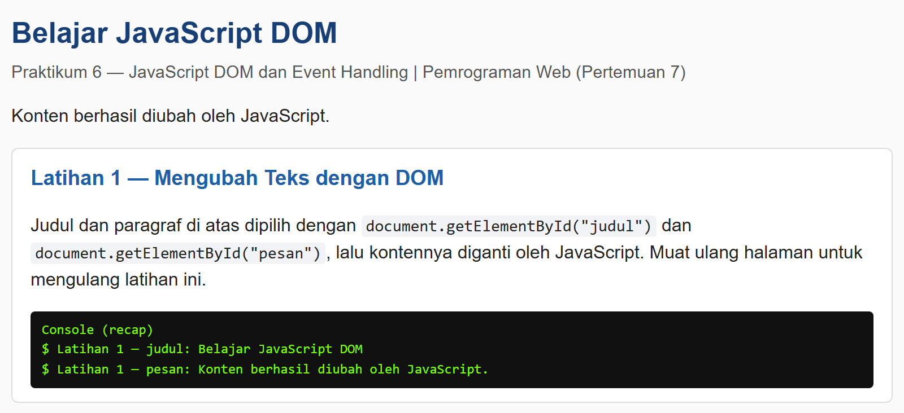

### Latihan 2 — Event click

Saat tombol diklik, teks paragraf `#pesan` diperbarui beserta waktu tindakan (event `click` + `addEventListener()`):

```js
const tombolAksi = document.getElementById("tombolAksi");

tombolAksi.addEventListener("click", function () {
    pesan.textContent = "Tombol diklik pada " + new Date().toLocaleTimeString();
    console.log("Latihan 2 —", pesan.textContent);
});
```

Diuji dengan menekan tombol berkali-kali — pesan selalu diperbarui dengan waktu terbaru (screenshot: `Tombol diklik pada 21:07:35`).

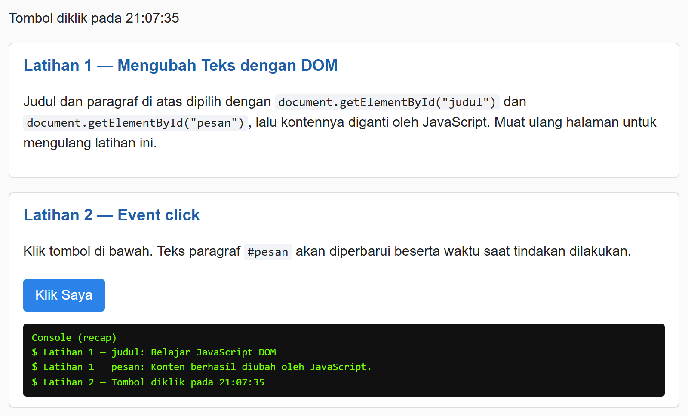

### Latihan 3 — Mengubah Kelas dan Gaya CSS

Aturan CSS sesuai modul ditambahkan ke `style.css`:

```css
.highlight {
    color: #173f75;
    background-color: #e6f1ff;
    border-left: 4px solid #3478c8;
    padding: 12px;
}
.teks-besar { font-size: 1.4rem; }
```

JavaScript mengganti kelas dengan `classList.toggle()`:

```js
const tombolGaya = document.getElementById("tombolGaya");
const teksGaya = document.getElementById("teksGaya");

tombolGaya.addEventListener("click", function () {
    teksGaya.classList.toggle("highlight");
    teksGaya.classList.toggle("teks-besar");
    console.log("Latihan 3 — class teksGaya:", teksGaya.className || "(kosong)");
});
```

| Kondisi | class `#teksGaya` | Tampilan |
|---|---|---|
| Sebelum diklik | *(kosong)* | paragraf biasa |
| Klik ke-1 | `highlight teks-besar` | blok biru muda, teks lebih besar |
| Klik ke-2 | *(kosong)* | kembali biasa |

Screenshot kondisi **aktif** (highlight + teks besar):

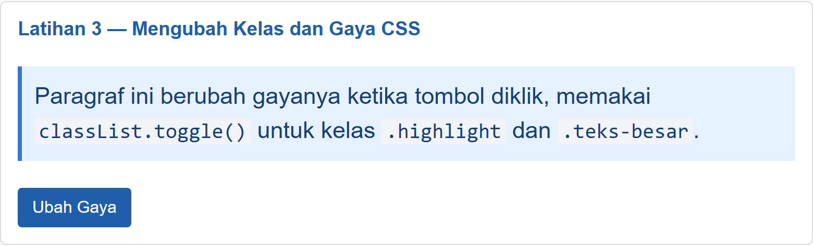

### Latihan 4 — Event input dan Penghitung Karakter

```js
const namaInput = document.getElementById("namaInput");
const jumlahKarakter = document.getElementById("jumlahKarakter");

namaInput.addEventListener("input", function () {
    jumlahKarakter.textContent = namaInput.value.length;
});
```

| Aksi | Jumlah karakter |
|---|---|
| Mengetik "Rafif Mizanurohman" | 18 |
| Menghapus semua | 0 |
| Menempelkan teks | langsung sesuai panjang teks |

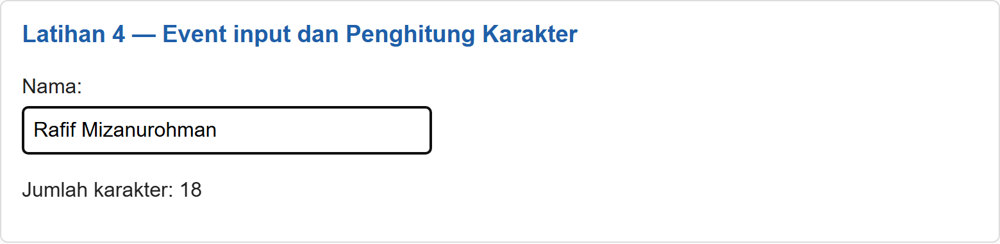

### Latihan 5 — Validasi Form Pendaftaran

Form memakai atribut `novalidate` sehingga validasi sepenuhnya dikendalikan JavaScript. Pada event `submit`, `event.preventDefault()` dipanggil agar halaman tidak dimuat ulang sebelum pemeriksaan selesai.

```js
form.addEventListener("submit", function (event) {
    event.preventDefault();

    const nama = document.getElementById("nama").value.trim();
    const email = document.getElementById("email").value.trim();
    const usiaInput = document.getElementById("usia").value;
    const usia = Number(usiaInput);
    const polaEmail = /^[^\s@]+@[^\s@]+\.[^\s@]+$/;

    pesanForm.className = "error";

    if (nama === "") {
        pesanForm.textContent = "Nama wajib diisi.";
    } else if (!polaEmail.test(email)) {
        pesanForm.textContent = "Masukkan email yang valid.";
    } else if (usiaInput === "" || !Number.isInteger(usia) || usia < 17 || usia > 100) {
        pesanForm.textContent = "Usia harus berupa bilangan bulat 17–100.";
    } else {
        pesanForm.className = "sukses";
        pesanForm.textContent = "Validasi berhasil. Form siap diproses.";
        form.reset();
    }

    console.log("Latihan 5 —", pesanForm.textContent);
});
```

Lima skenario pengujian sesuai modul:

| # | Skenario | Nama | Email | Usia | Pesan yang tampil |
|---|---|---|---|---|---|
| a | Semua kosong | — | — | — | Nama wajib diisi. |
| b | Nama kosong | — | rafif@contoh.com | — | Nama wajib diisi. |
| c | Email tidak valid | Rafif Mizanurohman | rafif.apel | 20 | Masukkan email yang valid. |
| d | Usia di bawah 17 | Rafif Mizanurohman | rafif@contoh.com | 15 | Usia harus berupa bilangan bulat 17–100. |
| e | Semua valid | Rafif Mizanurohman | rafif@contoh.com | 20 | Validasi berhasil. Form siap diproses. (form direset) |

**Kondisi tidak valid** (email `rafif.apel`):

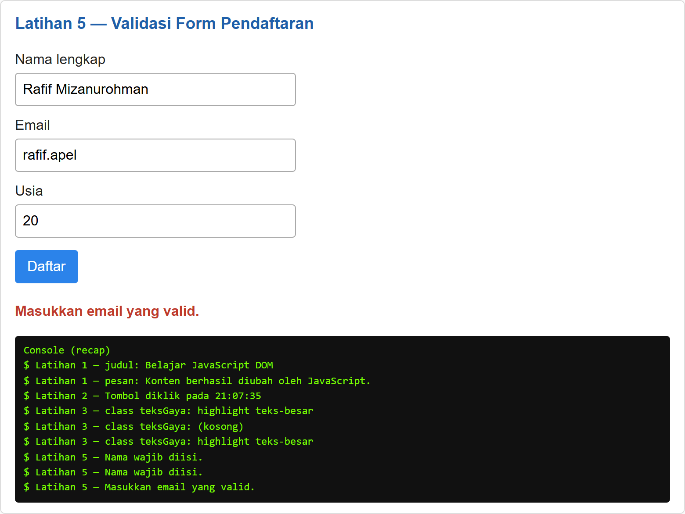

**Kondisi valid** (pesan sukses, form otomatis dikosongkan):

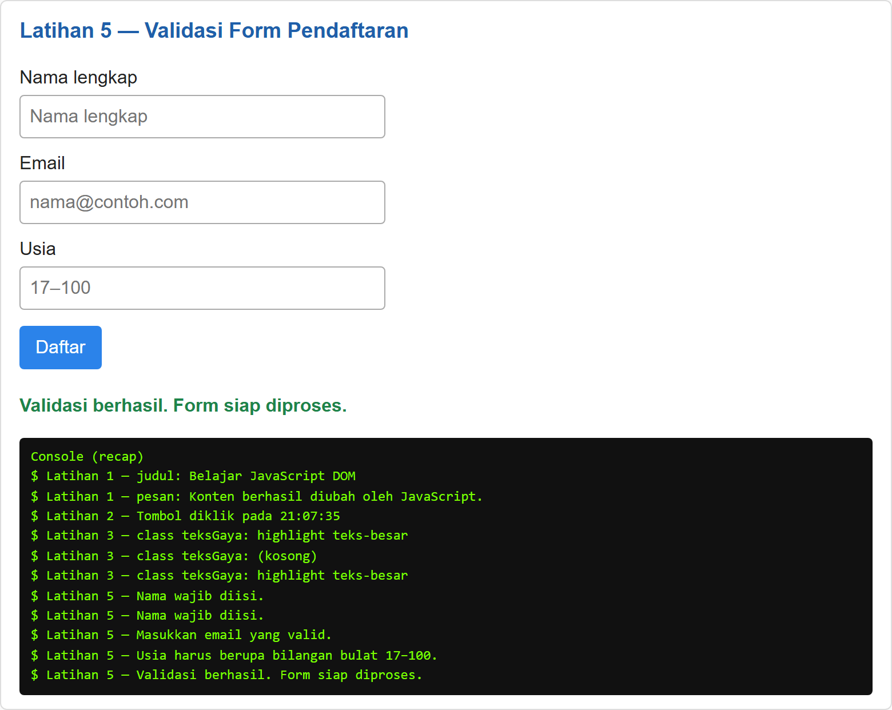

### Latihan 6 — Daftar Tugas (To-do List)

Item dibuat dengan `document.createElement()` dan teks pengguna ditampilkan memakai `textContent` (**bukan** `innerHTML`), sehingga aman dari markup berbahaya. Setiap item berisi label tugas, tombol *Tandai selesai*, dan tombol *Hapus* (Eksperimen 1).

```js
tambahTugas.addEventListener("click", function () {
    const teks = inputTugas.value.trim();

    if (teks === "") {
        pesanTugas.className = "error";
        pesanTugas.textContent = "Tulis tugas terlebih dahulu.";
        return;
    }

    daftarTugas.appendChild(buatItemTugas(teks));
    inputTugas.value = "";
    pesanTugas.className = "sukses";
    pesanTugas.textContent = "Tugas ditambahkan.";
    inputTugas.focus();
});
```

Pengujian:

| Aksi | Hasil |
|---|---|
| Klik Tambah dengan input kosong | "Tulis tugas terlebih dahulu." |
| Menambah 3 tugas (2 lewat tombol, 1 lewat tombol Enter) | 3 item masuk daftar |
| Klik *Tandai selesai* pada item pertama | teks tercoret (class `.selesai`), label berubah "Batalkan selesai" |
| Klik *Hapus* pada item ketiga | item terhapus, sisa 2 item |

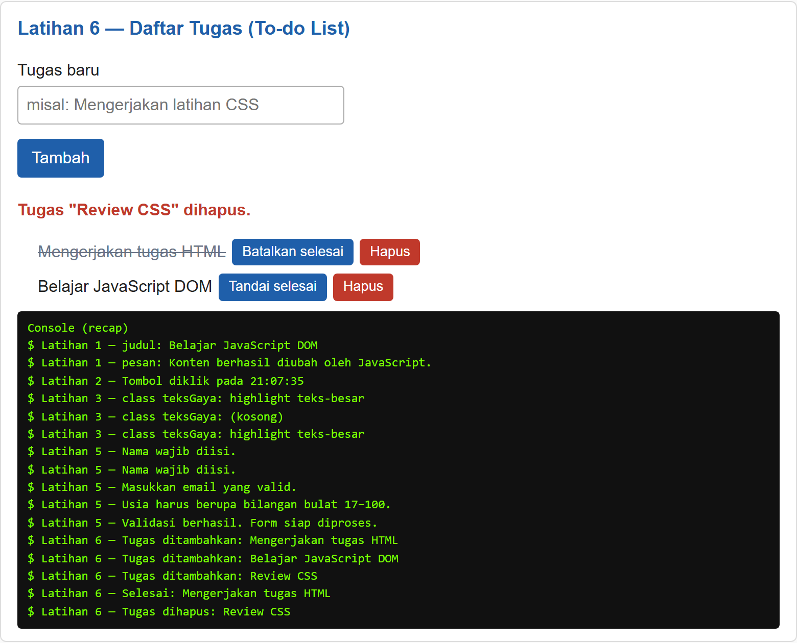

---

## Mini Project — Form Pendaftaran Workshop

Fitur interaktif (minimal tiga, di sini lima):

1. **Validasi nama, email, dan pilihan sesi** — pesan kesalahan tampil di halaman sesuai input pertama yang melanggar aturan.
2. **Penghitung karakter nama** (`#hitungNama`) — diperbarui saat mengetik (event `input`).
3. **Ringkasan input secara langsung** (`#isiRingkasan`) — nama, email, dan sesi ditampilkan real-time dari event `input` dan `change`.
4. **Pesan kesalahan dan pesan sukses** — `.error` (merah) dan `.sukses` (hijau).
5. **Tombol Reset** — mengosongkan form, penghitung, ringkasan, dan pesan.

Kode inti validasi:

```js
formWorkshop.addEventListener("submit", function (event) {
    event.preventDefault();

    const nama = wsNama.value.trim();
    const email = wsEmail.value.trim();
    const polaEmail = /^[^\s@]+@[^\s@]+\.[^\s@]+$/;

    if (nama === "") {
        tampilkanPesanWorkshop("Nama wajib diisi.", false);
    } else if (nama.length < 3) {                       // Eksperimen 2
        tampilkanPesanWorkshop("Nama minimal terdiri dari 3 karakter.", false);
    } else if (!polaEmail.test(email)) {
        tampilkanPesanWorkshop("Masukkan email yang valid.", false);
    } else if (wsSesi.value === "") {
        tampilkanPesanWorkshop("Silakan pilih sesi workshop terlebih dahulu.", false);
    } else {
        tampilkanPesanWorkshop(
            "Pendaftaran berhasil. " + nama + " terdaftar pada " + wsSesi.value + ".",
            true
        );
    }
});

// Ringkasan langsung (event input) + penghitung karakter
wsNama.addEventListener("input", function () {
    hitungNama.textContent = wsNama.value.length;
    perbaruiRingkasan();
});

// Eksperimen 3: event change pada dropdown sesi
wsSesi.addEventListener("change", function () {
    sesiTerpilih.textContent = wsSesi.value !== ""
        ? "Sesi terpilih: " + wsSesi.value
        : "Sesi terpilih: belum dipilih";
    perbaruiRingkasan();
});
```

Skenario pengujian:

| # | Skenario | Pesan yang tampil |
|---|---|---|
| a | Semua kosong | Nama wajib diisi. |
| b | Nama "Ra" (2 karakter) | Nama minimal terdiri dari 3 karakter. |
| c | Email `bukan-email` | Masukkan email yang valid. |
| d | Email valid, sesi belum dipilih | Silakan pilih sesi workshop terlebih dahulu. |
| e | Semua valid (nama Raf, email rafif@contoh.com, Sesi 1) | Pendaftaran berhasil. Raf terdaftar pada Sesi 1 — Pagi (09.00–11.00). |
| f | Klik tombol Reset | Form, penghitung, ringkasan, dan pesan dikosongkan |

**Kondisi error** — ringkasan input sudah tampil langsung walaupun form belum valid:

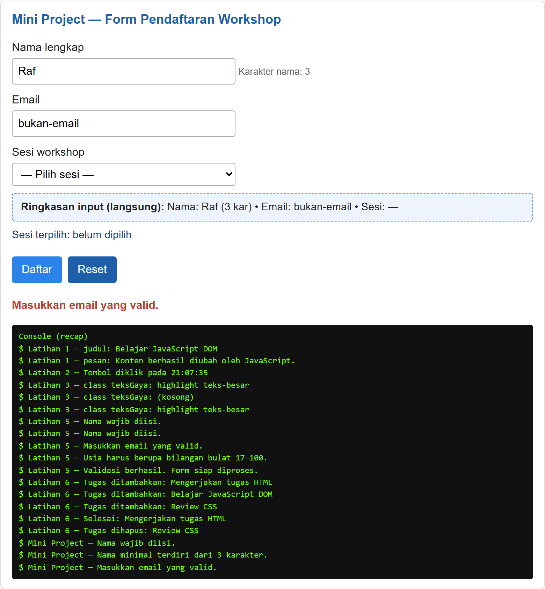

**Kondisi valid** — sesi terpilih tampil melalui event `change`, ringkasan lengkap, pesan sukses muncul:

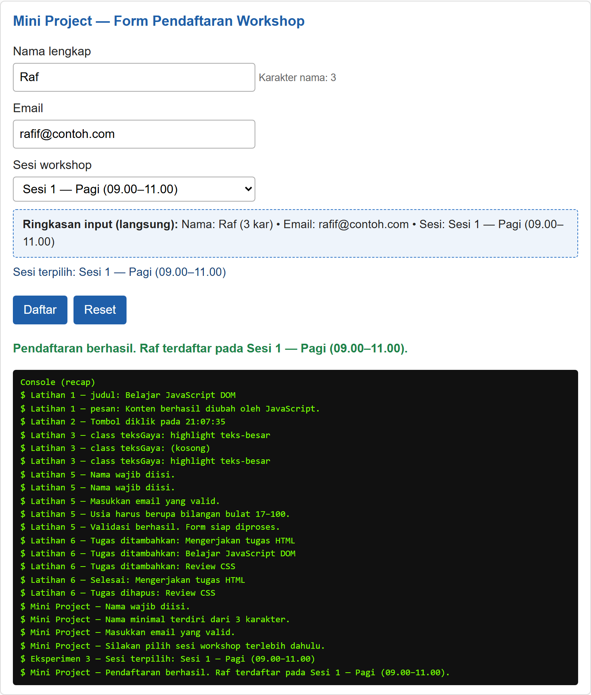

**Responsif di perangkat mobile (375 px)**:

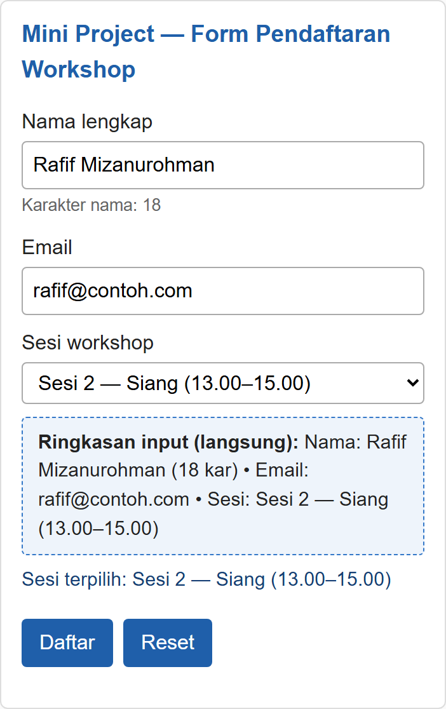

---

## Eksperimen Mandiri

| No | Eksperimen | Penerapan |
|---|---|---|
| 1 | Tombol hapus satu item To-do List | Setiap item **Latihan 6** diberi tombol *Hapus* — `item.remove()` menghapus item tersebut |
| 2 | Validasi nama minimal 3 karakter | Berlaku pada form **Mini Project** — `nama.length < 3` menghasilkan pesan "Nama minimal terdiri dari 3 karakter." |
| 3 | Event `change` pada dropdown sesi | Dropdown sesi **Mini Project** → teks `#sesiTerpilih` dan ringkasan diperbarui |
| 4 | Sembunyikan/tampilkan paragraf dengan class CSS | Tombol di bagian ini mengganti class `.tersembunyi` |
| 5 | Script tanpa `defer` di `<head>` | Halaman `eksperimen5.html` + analisis di bawah |

**Eksperimen 1 & 2 & 3** — terlihat pada screenshot Latihan 6 (tombol *Hapus*) dan Mini Project (validasi nama, sesi terpilih):

```js
// Eksperimen 1: hapus satu item
hapus.addEventListener("click", function () {
    item.remove();
    pesanTugas.textContent = 'Tugas "' + teks + '" dihapus.';
});

// Eksperimen 2: nama minimal 3 karakter
} else if (nama.length < 3) {
    tampilkanPesanWorkshop("Nama minimal terdiri dari 3 karakter.", false);
}
```

**Eksperimen 4 — Sembunyikan/tampilkan paragraf dengan class CSS**

CSS: `.tersembunyi { display: none; }` — JavaScript hanya mengganti class, tanpa mengubah `style` satu per satu:

```js
toggleParagraf.addEventListener("click", function () {
    paragrafToggle.classList.toggle("tersembunyi");
    console.log("Eksperimen 4 — paragraf tersembunyi:",
        paragrafToggle.classList.contains("tersembunyi"));
});
```

Kondisi tersembunyi (klik ke-1):

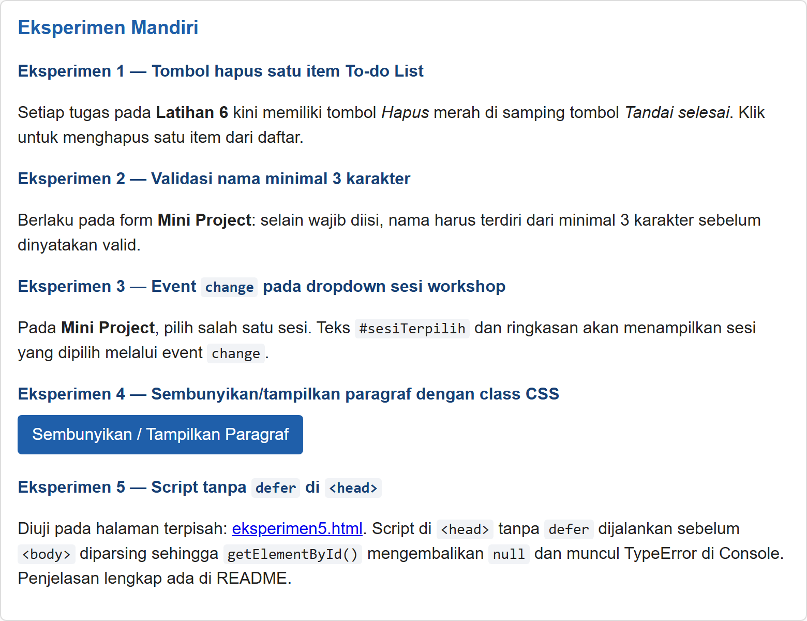

Kondisi tampil kembali (klik ke-2):

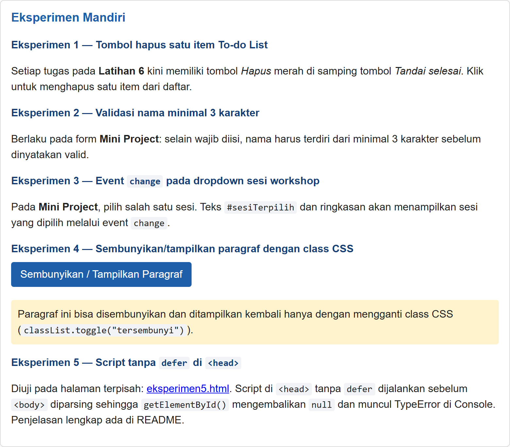

**Eksperimen 5 — Script tanpa `defer` di `<head>`**

Pada `eksperimen5.html`, script diletakkan di `<head>` **tanpa** `defer` sehingga dijalankan tepat di posisi itu, yaitu sebelum `<body>` diparsing:

```html
<head>
    <script>
        var judul = document.getElementById("judulEksperimen5"); // null
        judul.textContent = "Teks ini seharusnya berhasil diubah"; // TypeError
    </script>
</head>
```

Hasil pengamatan:

- `document.readyState` saat script berjalan = `"loading"` (HTML belum selesai diparsing).
- `document.getElementById("judulEksperimen5")` mengembalikan `null` karena elemennya belum ada.
- Muncul error: **`Uncaught TypeError: Cannot set properties of null (setting 'textContent')`** di Console.
- Akibatnya judul di halaman **tidak berubah** — perintah JavaScript gagal di tengah jalan.

Solusinya: beri atribut `defer` pada `<script>` (seperti `index.html`) atau pindahkan script ke akhir `<body>`.

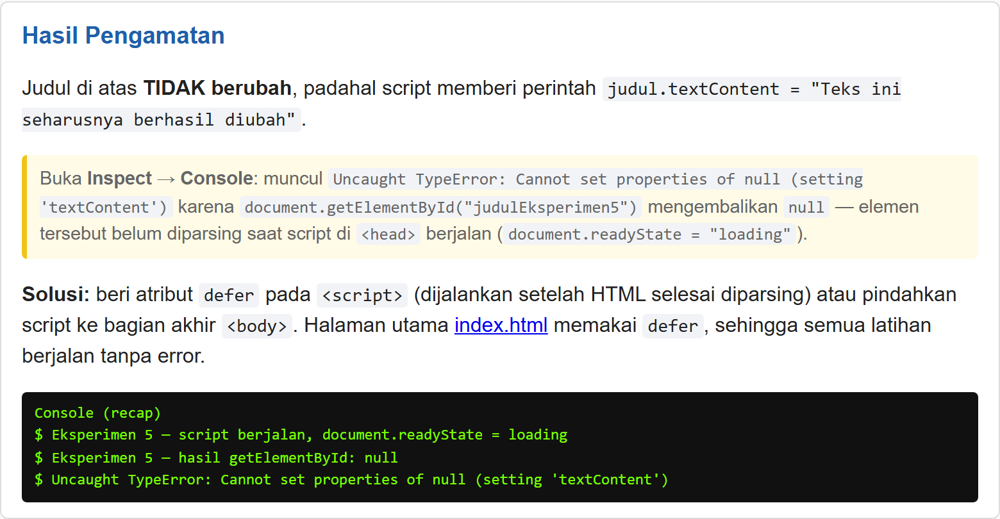

**Bagian Eksperimen Mandiri** (tampilan lengkap, paragraf terlihat):


---

## Hasil Pengujian Otomatis

Halaman diuji dengan browser headless (Playwright/Chromium) yang menjalankan interaksi nyata seperti pengguna. Hasil: **31 pemeriksaan — 31 PASS, 0 gagal**, antara lain:

- Latihan 1: teks judul & paragraf benar-benar berubah.
- Latihan 2: pesan berisi waktu klik.
- Latihan 3: class aktif saat diklik dan hilang saat diklik lagi (toggle).
- Latihan 4: penghitung = 18 saat mengetik, kembali 0 saat dihapus.
- Latihan 5: 5 skenario validasi sesuai modul + form direset setelah valid.
- Latihan 6: input kosong ditolak, 3 item masuk (termasuk via tombol Enter), tandai selesai bekerja, tombol Hapus menghapus item.
- Mini Project: 6 skenario (kosong, nama < 3, email salah, sesi kosong, valid, reset) + ringkasan langsung + event `change`.
- Eksperimen 4: class `.tersembunyi` masuk/keluar saat diklik.
- `index.html` berjalan **tanpa satu pun JavaScript error** (atribut `defer` bekerja).
- `eksperimen5.html`: judul tidak berubah dan terjadi `TypeError` sesuai prediksi.

---

## Jawaban Pertanyaan Evaluasi

### 1. Apa yang dimaksud dengan DOM dan apa manfaatnya?

DOM (Document Object Model) adalah representasi dokumen HTML dalam bentuk objek berupa pohon (tree) yang bisa diakses dan diubah oleh JavaScript. Setiap tag menjadi objek/-node — elemen, teks, dan atributnya bisa dibaca serta dimodifikasi.

Manfaatnya: program dapat memilih elemen, mengubah teks/atribut/gaya, menambah atau menghapus elemen, dan merespons tindakan pengguna (klik, ketik, kirim form) sehingga halaman menjadi interaktif dan dinamis **tanpa perlu memuat ulang halaman dari server**.

### 2. Apa perbedaan `getElementById()`, `querySelector()`, dan `querySelectorAll()`?

| Method | Mengembalikan | Selector | Pemakaian |
|---|---|---|---|
| `getElementById("id")` | Satu elemen (atau `null`) | Hanya `id` | Paling cepat, untuk elemen unik |
| `querySelector("sel")` | Satu elemen pertama yang cocok (atau `null`) | Selector CSS apa pun: `#id`, `.class`, `tag`, `tag.class`, gabungan | Fleksibel untuk selector apa pun |
| `querySelectorAll("sel")` | NodeList berisi **semua** elemen yang cocok | Selector CSS apa pun | Saat perlu memproses banyak elemen (di-loop dengan `forEach`) |

Contoh pada praktikum ini: `querySelectorAll(".item")` mengembalikan semua elemen berkelas `.item`, sedangkan `getElementById("judul")` hanya mengambil satu elemen `#judul`.

### 3. Apa fungsi `addEventListener()` dan sebutkan tiga contoh event

`addEventListener(event, fungsi)` mendaftarkan fungsi (handler) yang akan dijalankan otomatis oleh browser setiap kali event tertentu terjadi pada elemen. Keunggulannya: JavaScript terpisah dari HTML, satu event boleh punya lebih dari satu listener, dan listener bisa dilepas.

Tiga contoh event:

1. `click` — saat elemen diklik (tombol *Klik Saya*, *Tambah*, *Ubah Gaya*).
2. `input` — saat nilai input berubah saat pengguna mengetik (penghitung karakter).
3. `submit` — saat form dikirim (validasi form pendaftaran).

Contoh lain yang dipakai: `change` (dropdown sesi) dan `keydown` (tombol Enter pada input tugas).

### 4. Mengapa `event.preventDefault()` digunakan pada event `submit` form?

Karena perilaku bawaan (default) browser saat form disubmit adalah **mengirim data ke server dan memuat ulang halaman**. Dengan `preventDefault()`, proses itu dicegah sehingga:

1. JavaScript sempat memvalidasi seluruh input lebih dulu.
2. Pesan validasi (sukses/gagal) bisa ditampilkan di halaman tanpa halaman berpindah/reset.
3. Pemrosesan selanjutnya (misal mengirim via `fetch` atau menampilkan ringkasan) bisa dikendalikan penuh oleh program.

Karena itu form juga diberi atribut `novalidate` — agar pesan error bawaan browser tidak menutupi pesan validasi buatan sendiri.

### 5. Apa perbedaan `textContent` dan `innerHTML` dari sisi penggunaan dan keamanan?

| | `textContent` | `innerHTML` |
|---|---|---|
| Cara kerja | Mengambil/mengubah isi sebagai **teks biasa** | Menafsirkan string sebagai **markup HTML** |
| Penggunaan | Teks polos; kalau berisi `<b>` akan tampil literal | Menyisipkan elemen/tag baru ke dalam elemen |
| Keamanan | **Aman** — teks pengguna tidak pernah dijalankan sebagai HTML (mencegah XSS) | **Berisiko XSS** bila memuat input pengguna yang tidak dipercaya |
| Performa | Lebih ringan | Lebih berat karena HTML di-parse ulang |

Praktikum ini memakai `textContent` untuk menampilkan teks pengguna (to-do list, pesan validasi) — sesuai anjuran modul: *hindari memasukkan teks pengguna yang tidak dipercaya ke `innerHTML`*.

### 6. Bagaimana `classList.toggle()` membantu mengubah tampilan elemen?

`classList.toggle(kelas)` **menambah class jika belum ada dan menghapusnya jika sudah ada** — sehingga satu baris kode cukup untuk membalik kondisi tampilan (on/off), tanpa perlu menulis percabangan `if/else` sendiri.

Karena gaya visual dikumpulkan di CSS (`.highlight { … }`, `.tersembunyi { display: none; }`), mengubah tampilan cukup dengan mengganti class — CSS yang bekerja, bukan JavaScript yang menyetel style satu per satu. Ini membuat desain tetap rapi dan mudah dirawat.

```js
elemen.classList.toggle("highlight");   // aktif → nonaktif, nonaktif → aktif
elemen.classList.toggle("tersembunyi"); // sembunyikan / tampilkan paragraf
```

### 7. Sebutkan minimal tiga skenario pengujian validasi form

Skenario yang saya uji pada praktikum ini (form Latihan 5 dan Mini Project):

1. **Semua input kosong** → "Nama wajib diisi."
2. **Nama kosong saja** (email terisi) → tetap "Nama wajib diisi." (urutan pengecekan benar).
3. **Format email salah** (mis. `rafif.apel`, `bukan-email`) → "Masukkan email yang valid."
4. **Usia di luar rentang/tidak bulat** (15, atau kosong/bukan bilangan bulat) → "Usia harus berupa bilangan bulat 17–100."
5. **Semua input valid** → pesan sukses tampil dan form direset.
6. Tambahan pada Mini Project: **nama < 3 karakter** → "Nama minimal terdiri dari 3 karakter."; **sesi belum dipilih** → "Silakan pilih sesi workshop terlebih dahulu."; serta pengujian **tombol Reset**.

---

## Kesimpulan

Dari praktikum ini saya memahami DOM sebagai representasi objek dari dokumen HTML yang bisa dimanipulasi JavaScript: memilih elemen dengan `getElementById()`, `querySelector()`, dan `querySelectorAll()`, lalu mengubah teks (`textContent`), class (`classList.toggle()`), dan gaya melalui CSS. Event pengguna ditangani dengan `addEventListener()` — `click`, `input`, `change`, `keydown`, dan `submit` — sehingga halaman merespons pengguna tanpa memuat ulang. Pada form, `event.preventDefault()` membuat validasi berjalan penuh di halaman sebelum data diproses. Saya juga belajar pentingnya `defer` pada `<head>`: tanpanya, script berjalan sebelum DOM siap dan `getElementById()` mengembalikan `null` sehingga muncul TypeError (dibuktikan pada Eksperimen 5). Terakhir, teks dari pengguna selalu ditampilkan dengan `textContent` — bukan `innerHTML` — agar aman dari XSS.
